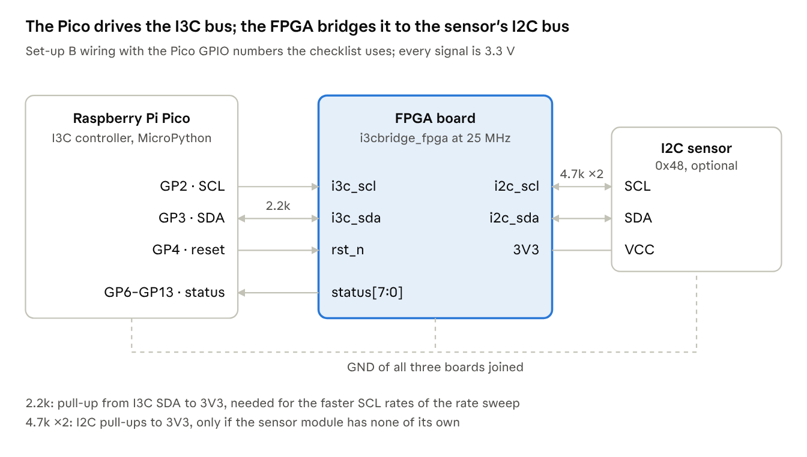

# FPGA dry run guide

This guide takes the I3C target → I2C bridge (top module `tt_um_i3cbridge`) through its first run on real pins: the design on an FPGA, the demo board's RP2 acting as the I3C controller, and an I2C sensor on the far side. It is the last check before the SKY26e submission closes on 30 Nov 2026.

## What the dry run proves and what you need

The dry run passes when the RP2 completes a **bridged I2C read** through the bridge running on the FPGA. It is the only test before silicon with real pins, real pull-ups and a controller that is not a simulation model.

What is already known before you start:

- The firmware's I3C frames and the whole bring-up checklist pass against the RTL in simulation: 31 checks with nothing on the I2C side, 32 with a sensor model (`python test/run.py -k firmware`).
- The design builds for the Tiny Tapeout FPGA breakout (iCE40UP5K): 556 of 5,280 logic cells, maximum clock 29.7 MHz, so 25 MHz is met.
- Never run on hardware: the firmware's pin and board layer (`players.py`, `pio_player.py`, `boards.py`, `dry_run.py`). This dry run is its first run, so a failure may be in that layer rather than in the bridge.

Use **set-up A** if you have the Tiny Tapeout demo board with the FPGA breakout: it is the same RP2, pins and commands as the silicon bring-up. Use **set-up B** with any other FPGA board and a Raspberry Pi Pico.

| Item | Set-up A: TT demo board | Set-up B: other FPGA board |
| --- | --- | --- |
| FPGA | TT FPGA breakout (iCE40UP5K) plugged into the demo board | Any board with 3.3 V I/O and about 600 free LUTs |
| I3C controller | The demo board's RP2, MicroPython SDK v3 already installed | Raspberry Pi Pico with MicroPython |
| PC software | Python 3 and `pip install mpremote` | The same, plus the FPGA vendor tools |
| Optional | 3.3 V I2C sensor module at 0x48 (LM75A, TMP102, TMP1075 or similar); a 2.2 kOhm resistor; a logic analyser | The same |

The checklist passes with nothing on the I2C side; a sensor adds a bridged read with real data.

**The kit.** The project folder holds `I3C_Bridge_FPGA_Dry_Run`, built from commit `da74cf1`. Later commits change no logic (only comments, documentation, the proof runner, the author line and the workflows' shuttle tag), so its bitstream matches the design being submitted.

| File | What it is |
| --- | --- |
| `tt_um_i3cbridge.bin` | Bitstream for the TT FPGA breakout, from the `fpga` workflow (GitHub Actions run 38229440233), about 100 kB |
| `firmware/i3cbridge/` | The MicroPython I3C controller library for the RP2 |
| `firmware/dry_run.py` | Loads the design, starts the 25 MHz clock and runs the checklist |
| `fpga_dry_run.md` | The same procedure as this guide, in the repository's words |
| `i3cbridge_fpga.v`, `rtl/` | Only for set-up B: the FPGA wrapper and the ten RTL files |

## Which board to use, and what else to buy

**Recommendation:** if your lab has a **PYNQ-Z2** (or another Zynq board such as a Zybo Z7 or ZedBoard), use it with a **Raspberry Pi Pico or Pico 2** as the I3C controller (set-up B). Only the FPGA fabric (PL) is used; the ARM cores and the PYNQ Linux image play no part. If you can get the Tiny Tapeout demo board with the FPGA breakout, prefer it (set-up A): it is the exact board the chip will sit on.

| Board | FPGA | Clock on the board | How to get 25 MHz | Notes |
| --- | --- | --- | --- | --- |
| TT demo board + FPGA breakout | iCE40UP5K | Made by the RP2 | Nothing to do: `dry_run.py` sets it | Best match to silicon; RP2 already on board, no Pico needed |
| PYNQ-Z2 | Zynq XC7Z020 | 125 MHz | Vivado Clocking Wizard: 125 → 25 MHz, `CLK_DIV` = 1 | 3.3 V Pmod, Arduino and Raspberry Pi headers; buttons for reset |
| Zybo Z7-10 / Z7-20 | Zynq XC7Z010 / 020 | 125 MHz | Clocking Wizard, `CLK_DIV` = 1 | 3.3 V Pmod ports |
| ZedBoard | Zynq XC7Z020 | 100 MHz | `CLK_DIV` = 4 | 3.3 V Pmod ports |
| Basys 3 / Nexys A7 | Artix-7 | 100 MHz | `CLK_DIV` = 4 | Simplest Xilinx option; 3.3 V Pmod ports |
| iCEBreaker | iCE40UP5K | 12 MHz | `CLK_DIV` = 1 runs the bridge at 12 MHz (I2C rates halve, timeout doubles), or use the iCE40 PLL for 25 MHz | Same chip as the TT breakout; open-source tools (Yosys, nextpnr) |

The wrapper's `CLK_DIV` only divides by 1, 2 or 4. Do **not** divide a 125 MHz clock by 4 or 8: 31.25 MHz would push the downstream I2C to 124 kHz, above the 100 kHz standard-mode limit, and 15.6 MHz is needlessly slow. Use the Clocking Wizard on 125 MHz boards.

**Raspberry Pi: use a Pico, not a Raspberry Pi 4 or 5.** The I3C controller firmware is MicroPython for the RP2 microcontroller (RP2040 on the Pico, RP2350 on the Pico 2). It uses `machine.Pin` and the RP2's PIO blocks, which a Linux Raspberry Pi does not have. A Pico costs a fraction of a Pi and is what the firmware was checked against in simulation.

**Shopping list for set-up B** (all 3.3 V; never use a 5 V module):

- [ ] Raspberry Pi Pico or Pico 2 with headers soldered (Pico H / Pico 2 H), and its micro-USB cable
- [ ] The FPGA board and its USB cable (USB-JTAG for programming)
- [ ] A breadboard and jumper wires (male-to-female for Pmod pins, male-to-male on the breadboard)
- [ ] One 2.2 kOhm resistor: I3C SDA pull-up for the faster SCL rates
- [ ] Two 4.7 kOhm resistors: I2C pull-ups, only if your sensor module has none
- [ ] Optional: a 3.3 V I2C temperature sensor module at address 0x48 (TMP102, LM75A or TMP1075 breakout)
- [ ] Optional: a USB logic analyser (8 channels, 24 MHz is enough for a 1 MHz bus) with PulseView

**Software:** Vivado (the free edition covers the XC7Z010/020 and Artix-7 parts) or the iCE40 open-source tools; the MicroPython UF2 for your Pico from micropython.org; Python 3 with `pip install mpremote` on the PC.

## Wiring

Five signal wires and a common ground join the Pico to the FPGA board, and three more join the FPGA board to the sensor.



Arrows show who drives each line: SCL and reset come from the Pico, the status bits come back from the FPGA, and both SDA lines are driven from either end.

**Set-up B pin table.** Put the ports on 3.3 V header pins (a Pmod port is easiest) and copy the package pins from your board's official constraints file (the master XDC for Xilinx boards).

| Pico | FPGA port (`i3cbridge_fpga`) | Design pin | Notes |
| --- | --- | --- | --- |
| GP2 | `i3c_scl` | `uio[2]` I3C SCL | Pico → FPGA |
| GP3 | `i3c_sda` | `uio[3]` I3C SDA | Both ways; 2.2 kOhm to 3V3 for the rate sweep |
| GP4 | `rst_n` | `rst_n` | Pico → FPGA; or a board button (leave `rst_n` out of `PicoBoard` and it asks you to press it) |
| GP6 … GP13 | `status[0]` … `status[7]` | `uo_out[7:0]`: DBG\_STATE\[3:0\], DA\_VALID, IRQ, BUSY, ERR | FPGA → Pico; leave out `uo` to skip these checks |
| — | `i2c_scl`, `i2c_sda` | `uio[6]`, `uio[7]` | To the sensor; pull-ups to 3V3 |
| — | `pid_inst[1:0]`, `i2c_fast` | `ui_in[2:1]`, `ui_in[3]` | Tie to 0 or to board switches (`i2c_fast` = 0 gives 99.2 kHz) |
| — | `clk_board` | `clk` | Board oscillator, made 25 MHz as in the board table |
| GND | GND | — | Common to all three boards |

SCL and SDA must be two consecutive GPIOs (GP2, GP3) so the PIO player can use them later.

**Set-up A has almost no wiring:** the FPGA breakout plugs into the demo board, and the SDK connects `uio[2]` and `uio[3]` to the RP2 (`boards.TTDemoBoard` finds the GPIOs itself). Only the sensor module is added, on the bottom-row `uio` Pmod: `uio[6]` = SCL, `uio[7]` = SDA, plus 3V3 and GND.

## Step 1: Put the design on the FPGA

**Set-up A (TT FPGA breakout).** Use `tt_um_i3cbridge.bin` from the kit. To build a fresh one, open the repository on GitHub, go to **Actions → fpga → Run workflow** on `main`, download the `fpga_bitstream` artifact when it finishes and take `build/tt_um_i3cbridge.bin` (about 100 kB). It is loaded onto the breakout in step 2.

**Set-up B on a Xilinx board (PYNQ-Z2, Zybo Z7, ZedBoard, Basys 3, Nexys A7) with Vivado:**

1. Create an RTL project for your board's part (PYNQ-Z2: `xc7z020clg400-1`), or pick the board in the Boards tab after installing its board files.
2. Add the ten files in `src/` (or the kit's `rtl/`) and `fpga/i3cbridge_fpga.v`.
3. **125 MHz boards (PYNQ-Z2, Zybo Z7):** add a Clocking Wizard from the IP Catalog with a 125 MHz input and one 25 MHz output, and make this file the top module so the wizard feeds the bridge:

```verilog
module dryrun_top (
    input  wire       sysclk,      // 125 MHz board clock
    input  wire       rst_n,       // from Pico GP4 (low = reset)
    input  wire       i3c_scl,
    inout  wire       i3c_sda,
    inout  wire       i2c_scl,
    inout  wire       i2c_sda,
    output wire [7:0] status       // to Pico GP6..GP13
);
  wire clk25, locked;
  clk_wiz_0 u_clk (.clk_in1(sysclk), .reset(1'b0), .clk_out1(clk25), .locked(locked));
  i3cbridge_fpga #(.CLK_DIV(1)) u_dut (
      .clk_board(clk25), .rst_n(rst_n & locked),
      .i3c_scl(i3c_scl), .i3c_sda(i3c_sda), .i2c_scl(i2c_scl), .i2c_sda(i2c_sda),
      .pid_inst(2'b00), .i2c_fast(1'b0), .status(status));
endmodule
```

**100 MHz boards (ZedBoard, Basys 3, Nexys A7):** the wizard is still the cleanest; the quick alternative is `i3cbridge_fpga` itself as the top with `CLK_DIV` = 4.

4. Write the constraints file: copy the pin lines for one clock and 13 signals (5 bus and reset pins on one Pmod, the 8 status pins on a second Pmod) from the board's master XDC, then add:

```tcl
set_property IOSTANDARD LVCMOS33 [get_ports -filter {DIRECTION != ""}]
set_property PULLUP true [get_ports {i3c_sda i2c_scl i2c_sda}]
create_clock -period 8.000 -name sysclk [get_ports sysclk]   ;# 10.000 on a 100 MHz board
```

5. Run synthesis, implementation and **Generate Bitstream**. Check the timing summary shows no failing paths.
6. Open **Hardware Manager → Open Target → Auto Connect → Program Device** over the board's USB-JTAG port. On a PYNQ-Z2 this works whatever is on the SD card; the board's DONE LED lights when the FPGA is programmed.

**Set-up B on an iCEBreaker** (open-source tools): synthesise with `yosys -p "synth_ice40 -top i3cbridge_fpga -json top.json" src/*.v fpga/i3cbridge_fpga.v`, place with `nextpnr-ice40 --up5k --package sg48 --pcf icebreaker.pcf --json top.json --asc top.asc` (add `-pullup yes` to the three bus pins in the PCF), then `icepack top.asc top.bin` and `iceprog top.bin`.

## Step 2: Put the firmware on the RP2

Run every command from inside the kit folder (`I3C_Bridge_FPGA_Dry_Run`), with the board connected by USB. Install the copy tool once: `pip install mpremote`.

**Set-up A (demo board).** The demo board's RP2 already runs the Tiny Tapeout MicroPython SDK. Copy the bitstream and the library, then restart:

```bash
mpremote fs mkdir :bitstreams
mpremote fs cp tt_um_i3cbridge.bin :bitstreams/tt_um_i3cbridge.bin
mpremote fs cp -r firmware/i3cbridge :
mpremote reset
```

`mkdir` reports an error if the folder already exists; that is fine. The SDK loads the bitstream onto the breakout when the design is selected in step 3.

**Set-up B (Pico).**

1. Download the MicroPython UF2 for your board from micropython.org/download (`RPI_PICO` for a Pico, `RPI_PICO2` for a Pico 2).
2. Hold the Pico's **BOOTSEL** button while plugging in the USB cable; it appears as a USB drive. Drag the UF2 onto it; the Pico restarts into MicroPython.
3. Copy the library: `mpremote fs cp -r firmware/i3cbridge :`
4. Check it imports: `mpremote exec "import i3cbridge; print('ok')"` should print `ok`.

The Pico and the FPGA board are now ready; leave both connected by USB (the FPGA board's USB also powers it).

## Step 3: Run the bring-up checklist

The checklist passes when its last line reads **`31 checks, 0 failed`** with nothing on the I2C side, or **`32 checks, 0 failed`** with a sensor at 0x48.

**Set-up A:** `mpremote run firmware/dry_run.py`. The script selects the design (the SDK loads the bitstream), starts the 25 MHz clock and runs the checklist with the bit-banged player; it ends with `DRY RUN PASSED` or the number of failed checks.

**Set-up B:** open the Pico's REPL with `mpremote` and type:

```python
from i3cbridge import boards, players, bringup
board = boards.PicoBoard(scl=2, sda=3, rst_n=4, uo=[6, 7, 8, 9, 10, 11, 12, 13])
player = players.BitBangPlayer(2, 3)
report = bringup.run_all(board, player, inst=0)
```

`inst=0` matches `pid_inst` tied to 0 in the FPGA; use the value of your switches if you wired them. Leave out `rst_n=4` to be asked to press the board's reset button, and `uo=` if the status pins are not wired (those checks are then skipped).

| Part | What it proves |
| --- | --- |
| 1. Reset state | Every status output is low and I3C SDA idles high (pull-up present) |
| 2. Dynamic address assignment | ENTDAA finds the bridge and gives it address 0x09; PID, BCR and DCR read back; RSTDAA clears it; SETDASA is refused; ENTDAA works again |
| 3. Status command | A private write and read round trip works with nothing on the I2C side |
| 4. Downstream I2C | With a sensor: a bridged 2-byte read. Without: the NACK path, padded data and the NACK flag |
| 5. HDR entry and exit | The bridge ignores 200 edges of HDR traffic and comes back on the exit pattern |
| 6. Parity error and aborted read | A bad T-bit sets ERR and the parity flag; an aborted read drops the rest; a new command clears the flag |

This is the passing run from simulation with a sensor whose register 0 reads `19 80`. On hardware the data bytes differ, and on set-up B the PID instance reads 0; everything else should match line for line.

```
== 1. Reset state
[PASS] after reset every status output is low - uo_out = 0x00
[PASS] I3C SDA is released and pulled high - if this fails, check the SDA pull-up

== 2. Dynamic address assignment
[PASS] ENTDAA finds one target and it ACKs the address - 1 found
       PID 0xFFFE00012000  BCR 0x01  DCR 0x00  DA 0x09
[PASS] PID: manufacturer 0x7FFF, fixed type, part 0x0001
[PASS] PID instance matches ui_in[2:1] - instance 2
[PASS] BCR = 0x01, DCR = 0x00
[PASS] DA_VALID is high - uo_out = 0x10
[PASS] a target that has an address does not answer ENTDAA
[PASS] RSTDAA is ACKed
[PASS] DA_VALID is low after RSTDAA - uo_out = 0x00
[PASS] the old address is not answered any more
[PASS] SETDASA is NACKed (not supported)
[PASS] ENTDAA works again after RSTDAA
[PASS] DA_VALID is high again - uo_out = 0x10

== 3. Status command (nothing needed on the I2C side)
[PASS] status round trip returns 0x00 - 0x00 (ok, FIFO count 0)
[PASS] the 7E-prefixed form of private transfers works

== 4. Downstream I2C (device at 0x48 if present)
[PASS] bridged read of 2 bytes from register 0 - data 19 80
       as a 16-bit temperature register (LM75 / TMP102 style): 25.50 C
[PASS] ERR is low after a good transfer - uo_out = 0x10
[PASS] bridged write is acknowledged - 0x00 (ok, FIFO count 0)
[PASS] plain read returns the same register - data 19 80

== 5. HDR entry and exit
[PASS] ENTHDR0 puts the target in HDR (state 8) - uo_out = 0x18
[PASS] it stays there through 200 edges of HDR traffic - uo_out = 0x18
[PASS] the exit pattern returns it to IDLE with its address - uo_out = 0x10
[PASS] the bridge still answers - 0x00 (ok, FIFO count 0)

== 6. Parity error and aborted read
[PASS] the write with a bad T-bit was ACKed at the address
[PASS] ERR is high and the target is back in IDLE - uo_out = 0x90
[PASS] status shows the parity error - 0x40 (PARITY, FIFO count 0)
[PASS] next command accepted
[PASS] read aborted by the controller after 1 byte
[PASS] the rest of the response is dropped (IRQ low, IDLE) - uo_out = 0x10
[PASS] a new command clears the parity flag - 0x00 (ok, FIFO count 0)
[PASS] the downstream NACK flag matches step 4 - 0x00 (ok, FIFO count 0)

32 checks, 0 failed
```

Without a sensor, part 4 checks the NACK path instead and the run ends with `31 checks, 0 failed`:

```
== 4. Downstream I2C (device at 0x48 if present)
       no device answered at 0x48: checking the NACK path instead
[PASS] a NACKed read is padded with zeros and sets the NACK flag - data 00 00, status 0x80 (NACK, FIFO count 0)
[PASS] ERR is high - uo_out = 0x90
[PASS] a NACKed write reports NACK and the unsent byte - 0x81 (NACK, FIFO count 1)
```

## Step 4: Bridged sensor read and SCL rate sweep

With a 3.3 V sensor at 0x48 on the I2C lines, part 4 of the checklist reads two bytes from its register 0: the bridged read that ends the dry run. Run the checklist again after plugging it in (set-up A: `mpremote run firmware/dry_run.py`; set-up B: the `run_all` line again). For a sensor at another address:

```python
report = bringup.run_all(board, player, inst=0, sensor=0x4A)   # set-up A: leave out inst=0
```

To list what answers on the I2C bus (after `run_all` the bridge has address 0x09):

```python
from i3cbridge.i3c import I3CController
from i3cbridge.bridge import Bridge
br = Bridge(I3CController(player), 0x09)
[hex(a) for a in br.scan()]
```

**Rate sweep (optional).** Fit the 2.2 kOhm pull-up from I3C SDA to 3V3, then:

```python
from i3cbridge.pio_player import PioPlayer
bringup.sweep(lambda hz: PioPlayer(board.scl_gpio, board.sda_gpio, hz), 0x09)
```

It prints how many of 20 status round trips succeed at each SCL rate from 100 kHz to 2 MHz. The design target is 1 MHz, and in simulation every round trip passes up to 1 MHz. The PIO player has never run on hardware: if it fails at every rate while the bit-banged checklist passes, the fault is in the player, not the bridge.

## Troubleshooting

Work down the checklist: the first failing line usually names the fault, and later failures follow from it.

| Symptom | Likely cause | What to check |
| --- | --- | --- |
| "I3C SDA is released and pulled high" fails | No pull-up on SDA, SCL and SDA swapped, or wrong GPIO numbers | SDA wire on GP3 and `i3c_sda`; the 2.2 kOhm resistor or the XDC `PULLUP` line |
| ENTDAA finds 0 targets | Bridge not running: no clock, reset held low, bitstream not loaded, or SCL / SDA not reaching `uio[2]` / `uio[3]` | Set-up A: `tt.auto_clocking_freq`. Set-up B: DONE LED, Clocking Wizard `locked`, common GND, Pmod pin numbers against the XDC |
| Every check fails on a Zynq board | The FPGA is not programmed, or the clock comes from the wrong pin | Program again from Hardware Manager; `sysclk` must be the board's 125 MHz PL clock pin from the master XDC |
| ENTDAA works once, "works again after RSTDAA" fails | DA\_VALID did not drop | Watch `uo_out` bit 4 after RSTDAA |
| Status shows TIMEOUT (0x10) with nothing on the I2C bus | The I2C lines sit low: no pull-ups on `uio[6]` / `uio[7]`, so the bridge waits for SCL to rise and gives up after 35 ms | Pull-ups on `i2c_scl` and `i2c_sda` |
| Status shows NACK (0x80) | No I2C device at that address | Expected without a sensor; otherwise check the sensor address with `br.scan()` |
| I2C rate measures 124 kHz, or timeouts end early | Bridge clock is 31.25 MHz: a 125 MHz board divided by 4 | Use the Clocking Wizard for exactly 25 MHz |
| Random failures on the FPGA only | Timing margin | Run the bridge at 12.5 MHz (set-up A: `boards.TTDemoBoard(tt, clock_hz=12_500_000)`; set-up B: a 12.5 MHz wizard output). I2C rates halve and the timeout doubles |
| `BridgeError: bridge never ACKed the private read` | The I2C transfer never ended and the timeout did not fire | The bridge clock frequency |
| `uo_out` checks fail but the data checks pass | Status pins wired in a different order | GP6 = `status[0]` … GP13 = `status[7]` |

## Recording the result

The dry run counts as done when a transcript ending in `0 failed` with a sensor (a real bridged read) is saved. Keep, for the report and the viva:

- [ ] The full transcript, with and without a sensor. Set-up A: `mpremote run firmware/dry_run.py > dry_run_with_sensor.txt`; set-up B: copy the REPL output into a text file.
- [ ] The board used, the bridge clock (25 MHz or the value you set) and the FPGA tool's maximum frequency from its timing report.
- [ ] The rate-sweep table, if you ran it.
- [ ] A logic-analyser capture of one ENTDAA and one bridged read, if you have an analyser: I3C SCL, I3C SDA, I2C SCL, I2C SDA and IRQ (`status[5]`).
- [ ] A photo of the set-up.
- [ ] Any change you had to make to `players.py`, `boards.py` or `dry_run.py`, so the repository copy can be corrected.

Afterwards, tick "Run the FPGA dry run on hardware" in the repository's `STATUS.md`. A firmware fix needs a new commit, and every commit reruns `test`, `gds` and `docs` (about an hour); all three must be green again before the import into the department account, and the shuttle closes on 30 Nov 2026.
